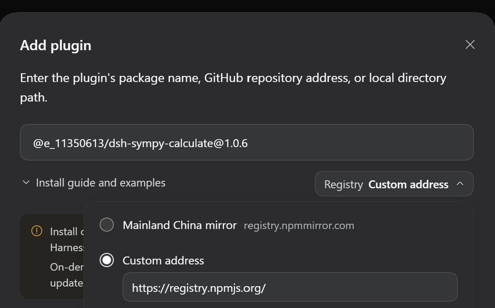

# SymPy-Calculate

A third-party DeepSeek Harness agent preset based on `minimal`. It adds one
stateless tool, `sympy_calculate`, which runs a complete Python script in a
fresh process against a local SymPy development checkout.

> **Security:** `sympy_calculate` executes arbitrary Python with the current
> user's permissions and inherited environment. It is not sandboxed. Enable
> it only in sessions whose model and permission policy you trust.

## Highlights

- Each call is bounded by a 120-second timeout; stdout and stderr are each capped at 2,000,000 characters.

## Requirements

| Requirement | Version / notes |
| --- | --- |
| DeepSeek Harness | [deepseek-ai/deepseek-harness@687f282e](https://github.com/deepseek-ai/deepseek-harness/commit/687f282e8625c6b8d11ff58211a90524be2e4317) |
| Node.js | `v22.23.2` |
| pnpm | `11.24.0` |
| git | `2.43.0` |
| Python | `3.12.3` |
| SymPy | [sympy/sympy@6aabf6a](https://github.com/sympy/sympy/commit/6aabf6ac9eddd1c5141ff9a3a35dcb53a7b02228) |
| OS | Ubuntu 24.04.4 LTS only |

Among shipped profiles, install into `web` only. The preset needs the
`agent-preset-registry` service supplied by the `web` bundle; in `headless`,
`sdk`, `sdk-minimal`, or `acp` it will not be selectable. A custom profile
can use the preset if it includes the `agent-preset-registry` service.

## Set up SymPy

The tool defaults to `~/sympy-dev/sympy` and its `venv`:

```sh
sudo apt install -y python3-venv
mkdir -p ~/sympy-dev
git clone https://github.com/sympy/sympy.git ~/sympy-dev/sympy
python3 -m venv ~/sympy-dev/sympy/venv
~/sympy-dev/sympy/venv/bin/python -m pip install -e ~/sympy-dev/sympy
```

For a different checkout or interpreter, set `SYMPY_ROOT` / `SYMPY_PYTHON`
before starting DSH.

## Install

The easiest way is from the Web UI: go to **Plugins → Add plugin**, enter
`@e_11350613/dsh-sympy-calculate@1.0.6`, choose **Custom address** under
**Registry**, and enter `https://registry.npmjs.org/`. Then select **Install**.
No GitHub URL or SSH key is needed.



Alternatively, from the CLI, install
[`@e_11350613/dsh-sympy-calculate`](https://www.npmjs.com/package/@e_11350613/dsh-sympy-calculate)
from npm into the `web` profile. If `dsh` is already on your `PATH`, replace
the `npx --yes @deepseek-ai/dsh@0.2.1-rc.2` prefix with `dsh`.

```sh
npx --yes @deepseek-ai/dsh@0.2.1-rc.2 plugin --profile web add \
  @e_11350613/dsh-sympy-calculate@1.0.6
```

<details>
<summary>Alternative installs: GitHub tarball, GitHub shorthand, or a DeepSeek Harness source checkout</summary>

HTTPS tarball, if you prefer to install directly from GitHub:

```sh
npx --yes @deepseek-ai/dsh@0.2.1-rc.2 plugin --profile web add \
  https://codeload.github.com/11350613/SymPy-Calculate/tar.gz/v1.0.6
```

Git shorthand, when GitHub SSH access is already configured:

```sh
npx --yes @deepseek-ai/dsh@0.2.1-rc.2 plugin --profile web add \
  github:11350613/SymPy-Calculate#v1.0.6
```

From a DeepSeek Harness source checkout, use `pnpm dsh`:

```sh
pnpm dsh plugin --profile web add \
  @e_11350613/dsh-sympy-calculate@1.0.6
```

</details>

Start or restart the `web` profile. **SymPy Calculate** will then be
available as an agent preset for new tasks.

## Verify

Check that the bundle and preset are in the composed config:

```sh
npx --yes @deepseek-ai/dsh@0.2.1-rc.2 --profile web --dump-config \
  | grep "SymPy Calculate"
```

Then start the UI and confirm that **SymPy Calculate** appears as an agent
preset without an error marker:

```sh
npx --yes @deepseek-ai/dsh@0.2.1-rc.2 --profile web --no-open
```

## Usage

`sympy_calculate` expects one complete script:

```json
{
  "code": "from sympy import *\n\nx = symbols('x')\nprint(integrate(x**2 / (1 + x**4), (x, -oo, oo)))\n"
}
```

Output:

```text
sqrt(2)*pi/2
```

Because every call starts a fresh interpreter and pays the SymPy import
cost, batch related computations into one script instead of making many
small calls. stdout and stderr are combined; a non-zero exit is returned as
a tool error.

## Troubleshooting

| Symptom | Fix |
| --- | --- |
| `sympy_calculate: no Python interpreter under ...` | Run the SymPy setup above, or export `SYMPY_ROOT` / `SYMPY_PYTHON` before starting `dsh`. |
| Remove the plugin | `npx --yes @deepseek-ai/dsh@0.2.1-rc.2 plugin --profile web remove @e_11350613/dsh-sympy-calculate` |
| Removal fails with `ERR_PNPM_MISSING_TARBALL_INTEGRITY` | Run `cd ~/.dsh/profiles/web && pnpm remove @e_11350613/dsh-sympy-calculate --config.trust-lockfile=true` (skips lockfile verification for this removal), then restart DSH. |

## Tested on

- SymPy-Calculate release: `v1.0.6`
- npm package: `@e_11350613/dsh-sympy-calculate@1.0.6`
- Ubuntu 24.04.4 LTS
- DeepSeek Harness commit: [deepseek-ai/deepseek-harness@687f282e](https://github.com/deepseek-ai/deepseek-harness/commit/687f282e8625c6b8d11ff58211a90524be2e4317)
- SymPy commit: [sympy/sympy@6aabf6a](https://github.com/sympy/sympy/commit/6aabf6ac9eddd1c5141ff9a3a35dcb53a7b02228)

## Issues

Bug reports and feature requests: <https://github.com/11350613/SymPy-Calculate/issues>

## License

MIT. See [LICENSE](LICENSE).
